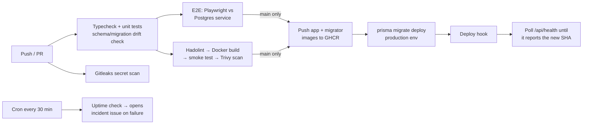

# Finova — Personal Finance & Investment Platform

[](https://github.com/nxl-krishna/finova/actions/workflows/ci.yml)
[](https://github.com/nxl-krishna/finova/actions/workflows/cd.yml)

Expense tracking, budgets, portfolio tracking with realized/unrealized P&L, net-worth history and a portfolio health analysis. Built with Next.js 15, TypeScript, PostgreSQL, Prisma and Recharts, and shipped as a container through a GitHub Actions pipeline.

## Delivery pipeline



| Workflow | What it does |
|---|---|
| [`ci.yml`](.github/workflows/ci.yml) | Type-check, Vitest unit tests (JUnit artifact), Prisma validate and migration drift check, Playwright E2E against a real Postgres, Dockerfile lint, image build with layer caching, container smoke test, Trivy CVE scan, Gitleaks |
| [`cd.yml`](.github/workflows/cd.yml) | Runs only after CI passes on `main`. Publishes SHA-tagged images to GHCR, runs migrations as a one-shot container behind a protected `production` environment, triggers the deploy, then verifies the live `/api/health` reports the new commit |
| [`uptime.yml`](.github/workflows/uptime.yml) | Scheduled health probe that opens (and de-duplicates) an `incident` issue when production is down |
| [`dependabot.yml`](.github/dependabot.yml) | Weekly grouped updates for npm, GitHub Actions and the Docker base image |

## Container

Multi-stage `Dockerfile` on `node:22-alpine`:
- **`runner`**: Next.js standalone output only. Runs as a non-root user and has a `HEALTHCHECK` on `/api/health`.
- **`migrator`**: a one-shot `prisma migrate deploy` job. Schema changes run as a separate step instead of during app startup.

```bash
docker compose up --build     # Postgres + migrations + app on http://localhost:3000
```

`GET /api/health` → `{"status":"ok","db":"up","latencyMs":3,"version":"<git sha>"}` (503 if the DB is unreachable).

## Local development

```bash
cp .env.example .env
docker compose up -d db
npm install
npm run db:migrate && npm run db:seed   # demo@finova.dev / password123
npm run dev
```

| Script | |
|---|---|
| `npm run typecheck` | TypeScript, no emit |
| `npm test` | Unit tests (finance maths, portfolio analysis) |
| `npm run test:e2e` | Playwright browser tests |
| `npm run db:migrate:new` | Create a new migration after editing `schema.prisma` |

## Enabling deployment

CD publishes images without any setup. To deploy as well, configure the repo's **production** environment (Settings → Environments):

| Name | Type | Example |
|---|---|---|
| `DATABASE_URL` | secret | Supabase session-pooler URL |
| `DEPLOY_HOOK_URL` | secret | Render / Railway deploy hook for an image-backed service |
| `APP_URL` | variable | `https://finova.onrender.com` |

Set `AUTH_SECRET` and `DATABASE_URL` on the hosting platform itself. Add required reviewers to the environment if you want a manual approval gate before production.

## Application security

- Signed httpOnly session cookies. Every server action and query re-checks the user and filters by their id, and an E2E test verifies one user can't see another's data.
- zod validation on all mutations. Security headers are set in `next.config.ts`.
